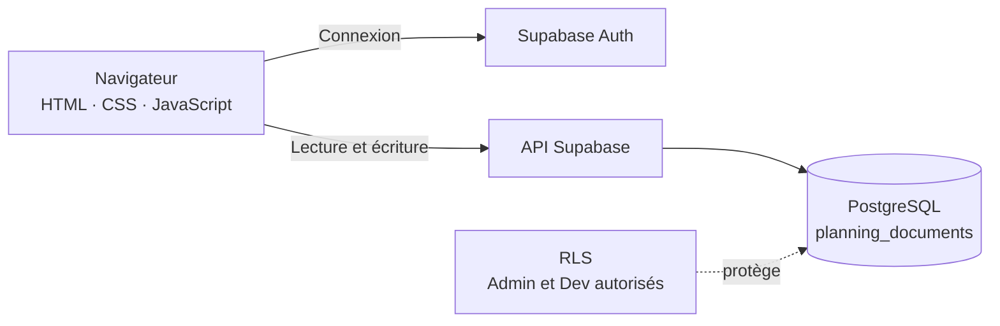

# Planning du personnel — Tante Adèle

**Application web de planning et de pointage pour trois boulangeries.** Réalisée par Imane OULD AMER pour centraliser les équipes et leurs horaires, puis consulter les totaux depuis plusieurs appareils.

**[Ouvrir la démo](https://imaneoa.github.io/tante-adele-pointage/)** · **[Voir le profil d’Imane](https://github.com/imaneoa)**

## Ce que fait l’application

- Gère séparément les équipes des Halles, de Corgnac et de Landouge.
- Permet d’ajouter des employés et de saisir leurs horaires par jour, matin et après-midi.
- Calcule les totaux hebdomadaires et mensuels.
- Exporte les plannings en CSV, Excel et PDF.
- Enregistre les données dans le cloud pour les retrouver après reconnexion depuis un autre appareil.
- Affiche un exemple de démonstration avant la création d’une équipe.

## Choix techniques

L’interface est une application statique HTML, CSS et JavaScript. GitHub Pages la sert; Supabase Auth gère la connexion et PostgreSQL conserve la configuration des équipes et les horaires mensuels en JSONB.

Les documents de configuration et les horaires sont séparés par boulangerie et par mois. L’application recharge les changements toutes les 20 secondes tant qu’elle reste ouverte; à la prochaine ouverture, elle relit les données enregistrées.

## Sécurité des données

- Les utilisateurs se connectent avec les noms **Admin** et **Dev**. L’application les associe à `admin@example.com` et `dev@example.com` dans Supabase Auth.
- Les règles Row Level Security limitent la lecture et l’écriture à ces deux comptes.
- Le site utilise uniquement la clé publique Supabase prévue pour le navigateur. Aucune clé `service_role` n’est incluse.
- Les mots de passe ne sont pas stockés dans le dépôt.

## Technologies

`HTML` · `CSS` · `JavaScript` · `Supabase Auth` · `PostgreSQL` · `Row Level Security` · `GitHub Pages`

## Reproduire le déploiement

1. Créer un projet Supabase et deux utilisateurs Auth: `admin@example.com` et `dev@example.com`, avec confirmation automatique.
2. Exécuter [`supabase-schema.sql`](supabase-schema.sql) dans le SQL Editor.
3. Renseigner le Project URL et la clé `publishable` dans [`supabase-config.js`](supabase-config.js). Garder la clé `service_role` hors du navigateur et du dépôt.
4. Publier `index.html` à la racine d’un dépôt public, puis activer GitHub Pages depuis la branche `main`.

## Importer une sauvegarde existante

Dans l’ancienne version, utiliser **Télécharger une copie**. Dans la démo en ligne, se connecter puis choisir **Restaurer une sauvegarde** et sélectionner le fichier exporté.

## À propos du projet

Ce projet met en pratique le développement d’une interface web orientée usage, la modélisation simple de données, l’authentification et les règles d’accès à une base partagée. Il accompagne le parcours d’Imane en Master 1 CRYPTIS — Sécurité informatique à l’Université de Limoges.
